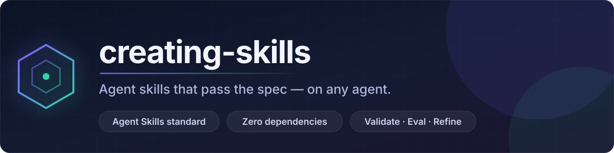

<p align="center">
  
</p>

<p align="center">
  <a href="https://www.npmjs.com/package/@vstlmkh/creating-skills"></a>
  <a href="https://agentskills.io/specification"></a>
  
  
  <a href="LICENSE"></a>
</p>

# creating-skills

An **agent-agnostic**, installable skill that generates new, spec-conformant skills
on request — applying the [Agent Skills open standard](https://agentskills.io/specification)
and the [agentskills.io skill-creation best practices](https://agentskills.io/skill-creation/best-practices),
through a ground → scaffold → fill → validate → evaluate → refine loop.

Because it conforms to the [Agent Skills open standard](https://agentskills.io),
portable output loads on any compliant agent. Explicit `kimi` and `claude` targets
also support host-specific frontmatter, arguments, and bundled-file variables.

## Zero dependencies

The utility scripts use the **Python 3.8+ standard library only**. No `pip install`,
no network access at runtime. If `python3` runs, the skill runs.

## What it does

Given a request like *"make me a skill for parsing invoices"*, it:

1. **Grounds** the skill in real expertise (a hands-on task or project artifacts),
   and settles name, description, and scope.
2. **Scaffolds** a conformant folder with `scripts/new_skill.py`.
3. **Fills** `SKILL.md` from the templates — calibrated instructions, a Gotchas
   section, deep material pushed into `references/`.
4. **Validates** with `scripts/validate_skill.py`, fixing findings until `PASS`.
5. **Evaluates** with at least three evals, including a with-skill / without-skill
   baseline.
6. **Refines** the description (trigger evals) and the skill (real execution traces).

## Install

### npm (recommended)

```bash
npx @vstlmkh/creating-skills install --agent kimi    # -> ~/.kimi-code/skills
npx @vstlmkh/creating-skills install --agent claude  # -> ~/.claude/skills
npx @vstlmkh/creating-skills install --agent cursor  # -> ~/.cursor/skills
npx @vstlmkh/creating-skills install --dir ./.kimi-code/skills --force
```

`--agent` knows `kimi`, `claude`, `cursor` and `codex`; without it, the installer
keeps the backward-compatible Claude default. For Kimi, `--agent kimi` respects
`KIMI_CODE_HOME` and otherwise uses `~/.kimi-code/skills`. `--dir` takes any skills
directory, project-local included. Nothing is written outside the target folder,
and an existing `creating-skills/` is only replaced with `--force`.

### Manual copy

The skill is the folder `skills/creating-skills/` — copy it into your agent's
skills directory:

```bash
cp -r skills/creating-skills ~/.kimi-code/skills/creating-skills # Kimi Code
cp -r skills/creating-skills ~/.claude/skills/creating-skills    # Claude Code
cp -r skills/creating-skills ~/.cursor/skills/creating-skills    # Cursor
cp -r skills/creating-skills <agent-skills-dir>/creating-skills  # any other
```

Any agent that reads the open-standard `SKILL.md` format works — the folder is the
unit of installation. Kimi also discovers project skills in `.kimi-code/skills/`
and `.agents/skills/`; Claude uses `.claude/skills/`.

## Usage

Once installed, just ask your agent to create a skill:

> "Create a skill called `managing-backups` for our nightly backup routine."

The skill activates, scaffolds the folder, fills it in, and validates it. You can
also run the tools directly:

```bash
# Portable Agent Skills output (default)
python3 skills/creating-skills/scripts/new_skill.py managing-backups --with-scripts
python3 skills/creating-skills/scripts/validate_skill.py managing-backups

# Kimi Code: Kimi frontmatter + ${KIMI_SKILL_DIR} for bundled scripts
python3 skills/creating-skills/scripts/new_skill.py managing-backups --target kimi --with-scripts
python3 skills/creating-skills/scripts/validate_skill.py managing-backups --target kimi

# Claude Code: Claude frontmatter + ${CLAUDE_SKILL_DIR} for bundled scripts
python3 skills/creating-skills/scripts/new_skill.py managing-backups --target claude --with-scripts
python3 skills/creating-skills/scripts/validate_skill.py managing-backups --target claude
```

Use `--dest ./.kimi-code/skills` or `--dest ./.claude/skills` to create a
project-local skill. After filling in the placeholders, invoke it as
`/skill:managing-backups` in Kimi Code or `/managing-backups` in Claude Code.
Host-specific output must be validated with the matching `--target`; the default
`portable` profile deliberately rejects host-only fields and variables.

## Reference

- `skills/creating-skills/references/best-practices.md` — the full practice set.
- `skills/creating-skills/references/descriptions.md` — trigger-eval method for
  tuning a description.
- `skills/creating-skills/references/evaluating.md` — baseline + assertions for
  output quality.
- `skills/creating-skills/references/scripts.md` — designing bundled scripts for
  agentic use.
- `skills/creating-skills/references/checklist.md` — pre-ship checklist.
- `skills/creating-skills/references/templates.md` — SKILL.md and eval templates.
- `skills/creating-skills/references/platforms.md` — Kimi Code and Claude Code
  locations, frontmatter, invocation, arguments, and skill-directory variables.

## Development

```bash
python3 -m unittest discover -s tests
```

## License

MIT.
